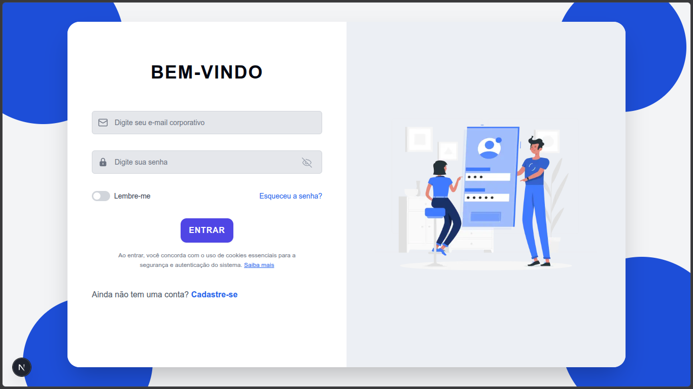
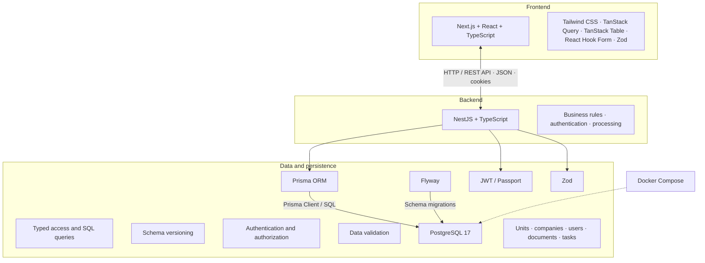

# FrotaSync

**Languages / Idiomas:** **[English](README.md)** · [Português (Brasil)](README.pt-BR.md)

**Units, Documents & Tasks Management System** — a frontend web app for tracking branches, yards, compliance documents, and related tasks.

**FrotaSync** is a full-stack application built with **Next.js**, **NestJS**, and **TypeScript**. It centralizes management of **units** (branches and yards), **documents** with automatic validity status, and **tasks** linked to each unit. The web frontend communicates with a REST API backed by **PostgreSQL** and **Prisma**, and the database schema is versioned with **Flyway**.

The scenario is a fictional carrier (**FrotaSync**) with branches and yards. Example documents: Environmental License, ANTT Registration, Cargo Insurance. Example task: _“Renew Recife yard license.”_

> **Academic / portfolio project** — Motiron Technologies Residency squad.

## Badges


<!-- Replace when CI/deploy exist:


-->

## Cover / demo

|   Dashboard indicators   |   Global document list   |       Unit detail        |
| :----------------------: | :----------------------: | :----------------------: |
| _Screenshot placeholder_ | _Screenshot placeholder_ | _Screenshot placeholder_ |



**Document validity rule** (computed on read — never stored or edited manually):

```ts
// lib/status.ts — UTC, Math.floor
const DAY_MS = 24 * 60 * 60 * 1000;
function utcDay(value: Date | string): number { ... }
export function calcularStatusDocumento(
  dataValidade: Date | string,
  hoje: Date = new Date(),
): DocumentoStatus {
  const diasRestantes = Math.floor(
    (utcDay(dataValidade) - utcDay(hoje)) / DAY_MS,
  );
  if (diasRestantes < 0) return "Expirado";
  if (diasRestantes <= 15) return "Próximo do vencimento";
  return "Válido";
}
```

## Table of contents

- [Installation and usage](#installation-and-usage)
- [Features](#features)
- [Architecture](#architecture)
- [Technologies](#technologies)
- [Project documentation](#project-documentation)
- [Contributors and license](#contributors-and-license)

## Installation and usage

### Prerequisites

- **Node.js** 20.19 or newer
- **npm**
- **Docker** and **Docker Compose**

### Local setup

From the project root:

```bash
cp .env.example .env
docker compose up -d db
```

Configure `backend/.env` from `backend/.env.example`, especially `DATABASE_URL`, `JWT_SECRET`, and the SMTP settings. Apply the SQL migrations in `backend/db/migration/` with Flyway before starting the API.

Install and start the backend:

```bash
cd backend
npm ci
npm run start:dev
```

In another terminal, install and start the frontend:

```bash
cd frontend
npm ci
cp .env.example .env.local
npm run dev
```

Open [http://localhost:3000](http://localhost:3000). The frontend uses `/api/v1` by default and proxies it to `http://127.0.0.1:3001` through Next.js. The API health check is available at [http://localhost:3001/health](http://localhost:3001/health).

### Scripts

| Command | Description |
| --- | --- |
| `npm run dev` | Development frontend server |
| `npm run build` | Production frontend build |
| `npm run start` | Run the production frontend build |
| `npm run lint` | Run frontend lint |
| `npm test` | Run frontend tests |
| `npm run typecheck` | Run Next.js type generation and TypeScript checks |

Backend scripts are available in `backend/`:

| Command | Description |
| --- | --- |
| `npm run start:dev` | Development API server |
| `npm run build` | Generate Prisma Client and compile the API |
| `npm run lint` | Run API lint |
| `npm test` | Run API tests |

## Features

- **Authentication** — Registration, email/password login, session refresh and logout, protected routes, password recovery, JWT, and CSRF protection.
- **Dashboard** — Unit, document, pending-task, and open-item indicators, backed by PostgreSQL and Prisma.
- **Units** — Listing with search, filters and pagination; create/edit units; unit detail; active/inactive status; unit change history.
- **Documents** — Global and per-unit lists, attachment upload, category filters, create/edit/delete, and automatic validity status: Valid / Due soon (≤15 days) / Expired.
- **Tasks** — Global and per-unit lists, create/edit/delete, and status workflow: Pending → In progress → Done.
- **Profile and preferences** — Profile screen and local preference settings.
- **UX and quality** — Responsive layout, loading/error/empty states, Zod validation, React Hook Form, TanStack Query and TanStack Table.

## Architecture



## Technologies

| Category                  | Stack                          |
| ------------------------- | ------------------------------ |
| Language                  | TypeScript, JavaScript         |
| Frontend                  | Next.js, React, Tailwind CSS   |
| Backend                   | NestJS                         |
| Forms & validation        | React Hook Form, Zod           |
| Data & tables             | TanStack Query, TanStack Table |
| Persistence               | PostgreSQL, Prisma             |
| Schema migrations         | Flyway                         |
| Authentication            | JWT, secure HTTP-only cookies  |
| Local infrastructure      | Docker Compose                 |
| IDE                       | Visual Studio Code             |

## Project documentation

| Document | Description |
| --- | --- |
| [`Analise_de_Requisitos_v1_4.md`](plan/versao_final/Analise_de_Requisitos_v1_4.md) | Functional and non-functional requirements |
| [`Estorias_de_usuario_v1_4.md`](plan/versao_final/Estorias_de_usuario_v1_4.md) | User stories and backlog |
| [`Design_de_API_v1_6.md`](plan/versao_final/Design_de_API_v1_6.md) | REST API contract |
| [`Modelagem_de_Dados_v1_6.md`](plan/versao_final/Modelagem_de_Dados_v1_6.md) | PostgreSQL data model and persistence architecture |
| [`infra_aws_v1_5.md`](plan/versao_final/infra_aws_v1_5.md) | Infrastructure, deployment and observability |

## Contributors and license

**Development squad (Motiron Residency):**

Valdir · Filipe · Gabrielly · Lucas Vinícius · Murilo · Niedson · Silas

**License:** [MIT](LICENSE) — Copyright (c) 2026 valdir_luz
