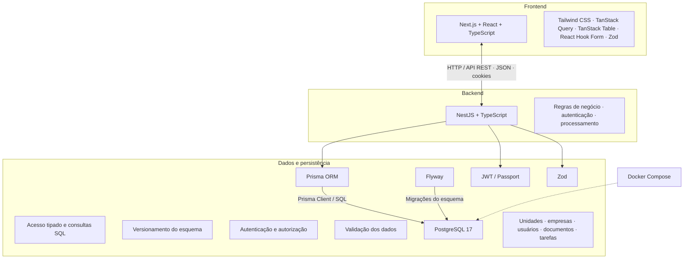

# FrotaSync

**Idiomas / Languages:** [English](README.md) · **[Português (Brasil)](README.pt-BR.md)**

**Sistema de Gestão de Unidades, Documentos e Tarefas** — aplicação web frontend para acompanhar filiais, pátios, documentos de conformidade e tarefas relacionadas.

O **FrotaSync** é uma aplicação full stack em **Next.js**, **NestJS** e **TypeScript** que centraliza a gestão de **unidades** (filiais e pátios), **documentos** com status de validade calculado automaticamente e **tarefas** vinculadas a cada unidade. O frontend se comunica com uma API REST apoiada em **PostgreSQL** e **Prisma**, enquanto o esquema do banco é versionado com **Flyway**.

Cenário: transportadora fictícia **FrotaSync**. Documentos exemplo: Licença Ambiental, Registro na ANTT, Seguro de Carga. Tarefa exemplo: *“Renovar licença do pátio de Recife”*.

> **Projeto acadêmico / portfólio** — squad da Residência Motiron Technologies.

## Badges


<!-- Substitua quando CI/deploy existirem:


-->

## Capa / demonstração

| Indicadores do Dashboard | Lista global de documentos | Detalhe da unidade |
| :---: | :---: | :---: |
| *Espaço reservado para screenshot* | *Espaço reservado para screenshot* | *Espaço reservado para screenshot* |

Inclua capturas em `docs/images/` e atualize os links quando a interface estiver pronta.

**Regra de validade do documento** (calculada na leitura — nunca persistida nem editada manualmente):

```ts
// lib/status.ts — UTC, Math.floor
const DAY_MS = 24 * 60 * 60 * 1000;
function utcDay(value: Date | string): number { ... }
export function calcularStatusDocumento(
  dataValidade: Date | string,
  hoje: Date = new Date(),
): DocumentoStatus {
  const diasRestantes = Math.floor(
    (utcDay(dataValidade) - utcDay(hoje)) / DAY_MS,
  );
  if (diasRestantes < 0) return "Expirado";
  if (diasRestantes <= 15) return "Próximo do vencimento";
  return "Válido";
}
```

## Índice

- [Instalação e uso](#instalação-e-uso)
- [Funcionalidades](#funcionalidades)
- [Arquitetura](#arquitetura)
- [Tecnologias](#tecnologias)
- [Documentação do projeto](#documentação-do-projeto)
- [Contribuidores e licença](#contribuidores-e-licença)

## Instalação e uso

### Pré-requisitos

- **Node.js** 20.19 ou superior
- **npm**
- **Docker** e **Docker Compose**

### Configuração local

A partir da raiz do projeto:

```bash
cp .env.example .env
docker compose up -d db
```

Configure `backend/.env` a partir de `backend/.env.example`, especialmente `DATABASE_URL`, `JWT_SECRET` e as configurações SMTP. Antes de iniciar a API, aplique as migrações SQL de `backend/db/migration/` com o Flyway.

Instale e execute o backend:

```bash
cd backend
npm ci
npm run start:dev
```

Em outro terminal, instale e execute o frontend:

```bash
cd frontend
npm ci
cp .env.example .env.local
npm run dev
```

Acesse [http://localhost:3000](http://localhost:3000). Por padrão, o frontend usa `/api/v1` e encaminha as chamadas para `http://127.0.0.1:3001` via Next.js. O healthcheck da API está em [http://localhost:3001/health](http://localhost:3001/health).

### Scripts

| Comando | Descrição |
| --- | --- |
| `npm run dev` | Servidor de desenvolvimento do frontend |
| `npm run build` | Build de produção do frontend |
| `npm run start` | Executa o build de produção do frontend |
| `npm run lint` | Executa o lint do frontend |
| `npm test` | Executa os testes do frontend |
| `npm run typecheck` | Gera tipos do Next.js e executa verificações TypeScript |

Os scripts do backend ficam em `backend/`:

| Comando | Descrição |
| --- | --- |
| `npm run start:dev` | Servidor de desenvolvimento da API |
| `npm run build` | Gera o Prisma Client e compila a API |
| `npm run lint` | Executa o lint da API |
| `npm test` | Executa os testes da API |

## Funcionalidades

- **Autenticação** — Cadastro, login com e-mail e senha, atualização e encerramento de sessão, rotas protegidas, recuperação de senha, JWT e proteção CSRF.
- **Dashboard** — Indicadores de unidades, documentos, tarefas pendentes e pendências abertas, obtidos pelo PostgreSQL e Prisma.
- **Unidades** — Listagem com pesquisa, filtros e paginação; cadastro e edição; detalhamento; status ativo/inativo; histórico de alterações.
- **Documentos** — Listas global e por unidade, upload de anexos, filtro por categoria, cadastro/edição/exclusão e status automático: Válido / Próximo do vencimento (≤15 dias) / Expirado.
- **Tarefas** — Listas global e por unidade, cadastro/edição/exclusão e fluxo de status: Pendente → Em andamento → Concluída.
- **Perfil e preferências** — Tela de perfil e configurações locais de preferência.
- **UX e qualidade** — Layout responsivo, estados de carregamento/erro/vazio, Zod, React Hook Form, TanStack Query e TanStack Table.

## Arquitetura



## Tecnologias

| Categoria | Stack |
| --- | --- |
| Linguagem | TypeScript, JavaScript |
| Frontend | Next.js, React, Tailwind CSS |
| Backend | NestJS |
| Formulários e validação | React Hook Form, Zod |
| Dados e tabelas | TanStack Query, TanStack Table |
| Persistência | PostgreSQL, Prisma |
| Migrações de schema | Flyway |
| Autenticação | JWT, cookies HTTP-only seguros |
| Infraestrutura local | Docker Compose |
| IDE | Visual Studio Code |

## Documentação do projeto

| Documento | Descrição |
| --- | --- |
| [`Analise_de_Requisitos_v1_4.md`](plan/versao_final/Analise_de_Requisitos_v1_4.md) | Requisitos funcionais e não funcionais |
| [`Estorias_de_usuario_v1_4.md`](plan/versao_final/Estorias_de_usuario_v1_4.md) | Estórias de usuário e backlog |
| [`Design_de_API_v1_6.md`](plan/versao_final/Design_de_API_v1_6.md) | Contrato da API REST |
| [`Modelagem_de_Dados_v1_6.md`](plan/versao_final/Modelagem_de_Dados_v1_6.md) | Modelagem PostgreSQL e arquitetura de persistência |
| [`infra_aws_v1_5.md`](plan/versao_final/infra_aws_v1_5.md) | Infraestrutura, implantação e observabilidade |

## Contribuidores e licença

**Squad de desenvolvimento (Residência Motiron):**

Valdir · Filipe · Gabrielly · Lucas Vinícius · Murilo · Niedson · Silas

**Licença:** [MIT](LICENSE) — Copyright (c) 2026 valdir_luz
